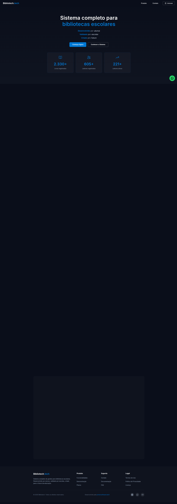
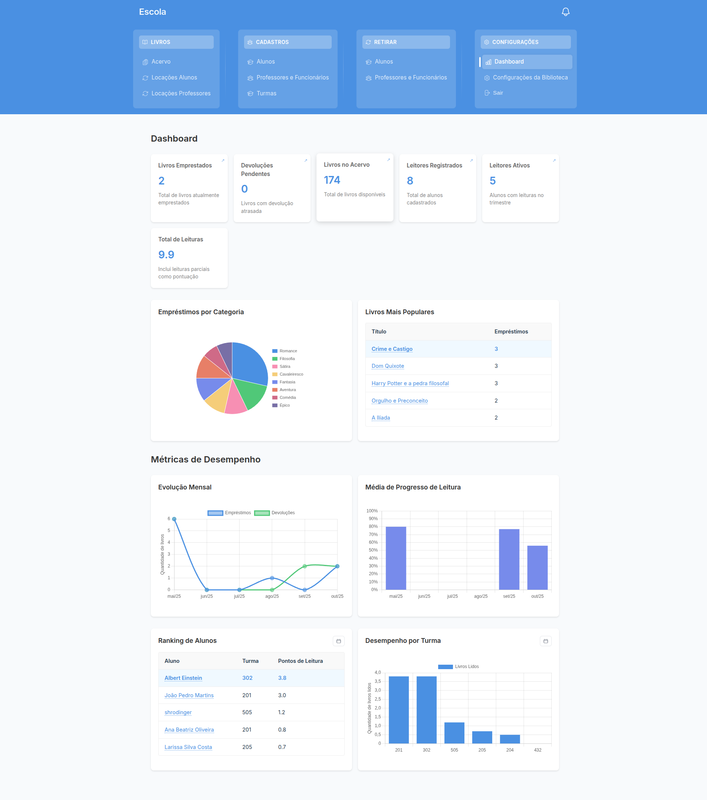
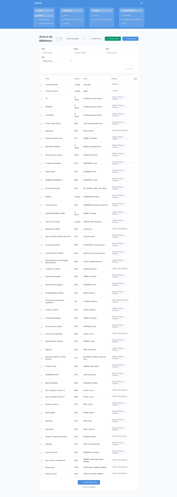
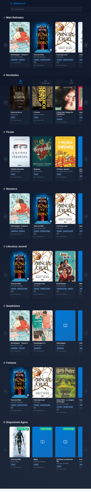

# 📚 Bibliotech

**Sistema de gestão para bibliotecas escolares, feito para os alunos usarem.** O aluno vê no celular todos os livros da biblioteca da escola, com capa e título, reserva o que quer ler e só passa na biblioteca para retirar.

🌐 **App em produção:** [bibliotech.gustavoalmeida.tech](https://bibliotech.gustavoalmeida.tech) · Produto da **Proton Software**, criado por [Gustavo Almeida](https://gustavoalmeida.tech)

| Em uso | Resultado | Modelo |
|---|---|---|
| **3 escolas** usando todos os dias | **+80% na taxa de leitura** em uma das escolas | SaaS com plano pago mensal |

---

## O problema

Tudo começou quando vi que a bibliotecária da escola controlava os empréstimos **no papel**. Os alunos não sabiam quais livros existiam, a bibliotecária não tinha nenhum dado sobre leitura e cada empréstimo virava burocracia. O Bibliotech digitaliza esse fluxo e coloca o acervo no bolso do aluno.

## O que o sistema faz

**Para os alunos**
- Catálogo com capa, título, autor e disponibilidade, organizado em seções (mais retirados, novidades, por gênero, disponíveis agora)
- **Reserva pelo celular** e retirada na biblioteca
- Recomendações e a **BiblioIA**, um assistente que sugere livros *do acervo da própria escola*
- Estatísticas de leitura pessoais e da turma

**Para a biblioteca (gestores)**
- Acervo completo (ISBN, autores, editora, gêneros, capas) com busca e filtros
- Alunos, turmas, professores e funcionários
- Empréstimos e devoluções com prazos, atrasos e histórico
- Dashboard com métricas: livros mais lidos, leitura por turma, evolução mensal, ranking de leitores
- Virada de ano letivo, backup e exportação (PDF / Excel)
- Assinatura do plano pelo Stripe

<p align="center">
  
</p>

| Dashboard do gestor | Catálogo | Área do aluno |
|:---:|:---:|:---:|
|  |  |  |

---

## Stack e por que cada escolha

| Camada | Tecnologia | Por que |
|---|---|---|
| Frontend | **React 18 + TypeScript** | SPA com muitas telas interativas (dashboard, catálogo, formulários); TypeScript evita erro de modelo de dados entre aluno, livro e empréstimo |
| Estilo | **Tailwind CSS** (+ styled-components em telas antigas) | Velocidade para montar telas responsivas; o aluno usa quase sempre pelo celular |
| Banco de dados | **Cloud Firestore** | Leitura em tempo real e escala sem servidor para manter; o modelo por escola (multi-tenant por documento) encaixa bem em coleções |
| Autenticação | **Firebase Auth** (gestores) | Login, recuperação de senha e sessão prontos e seguros, sem backend próprio |
| Backend | **Cloud Functions** | Tudo que precisa de segredo fica no servidor: checkout e webhook do Stripe e a chamada da IA |
| Pagamentos | **Stripe** (Checkout + webhooks) | Assinatura recorrente com cartão sem eu guardar dado de pagamento |
| IA | **OpenRouter** (modelos gratuitos, com fallback) | Custo zero por mensagem; se um modelo cai, a função tenta o próximo |
| Gráficos e relatórios | Chart.js, jsPDF, SheetJS | Métricas visuais para a escola e exportação para a secretaria |
| Deploy | Vercel (front) + Firebase (functions) | Deploy automático a cada push e functions perto do banco |

## Arquitetura

```
Navegador (React)
  ├── Firestore  ← leitura/escrita dos dados da escola (protegido por regras)
  ├── Firebase Auth  ← login dos gestores
  └── Cloud Functions
        ├── createCheckoutSession / verifyCheckoutSession / stripeWebhook → Stripe
        └── bookChat → OpenRouter (a chave da API fica só no servidor)
```

## Segurança

- Nenhuma chave secreta fica no frontend: Stripe e OpenRouter são chamados só pelas Cloud Functions, com segredos no Secret Manager / config do Firebase.
- As funções aceitam apenas as origens do app (CORS restrito). O checkout identifica o usuário pelo **Firebase ID token**, não por um `userId` enviado pelo navegador.
- O chat valida o payload (só mensagens de usuário/assistente, tamanho limitado), monta o prompt de sistema no servidor e tem rate limit.
- **Ponto em aberto:** os alunos entram com o ID estudantil, sem senha, para facilitar o uso em sala. Isso é uma decisão de produto; as regras do Firestore precisam limitar o que esse acesso consegue ler. As regras são configuradas no Console do Firebase e ainda não estão versionadas neste repositório.

## Como rodar

Pré-requisitos: Node.js 18+ e um projeto Firebase (Auth + Firestore).

```bash
git clone https://github.com/GustavoAlmeidaDoNascimento/Bibliotech.git
cd Bibliotech
npm install
cp .env.example .env   # preencha as variáveis REACT_APP_FIREBASE_*
npm start              # http://localhost:3000
```

Cloud Functions (opcional, para checkout e BiblioIA):

```bash
cd functions && npm install
firebase functions:secrets:set OPENROUTER_API_KEY
npm run build && firebase deploy --only functions
```

## Estrutura

```
src/
  pages/        telas (dashboard, livros, alunos, empréstimos, área do aluno, checkout…)
  components/   componentes por domínio
  contexts/     estado global (auth, escola do aluno, notificações, virada de ano)
  services/     acesso ao Firebase, Stripe e BiblioIA
functions/      Cloud Functions (Stripe + chat)
docs/           screenshots
```

## Próximos passos

- [ ] Versionar as regras do Firestore no repositório
- [ ] Notificações push e lembretes de devolução
- [ ] Migrar de Create React App para Vite
- [ ] App mobile nativo

---

**Licença:** código publicado como portfólio. Não há licença open source; todos os direitos reservados à Proton Software.

**Contato:** [gustavo@gustavoalmeida.tech](mailto:gustavo@gustavoalmeida.tech) · [gustavoalmeida.tech](https://gustavoalmeida.tech) · [Proton Software no LinkedIn](https://www.linkedin.com/company/107289200/)
